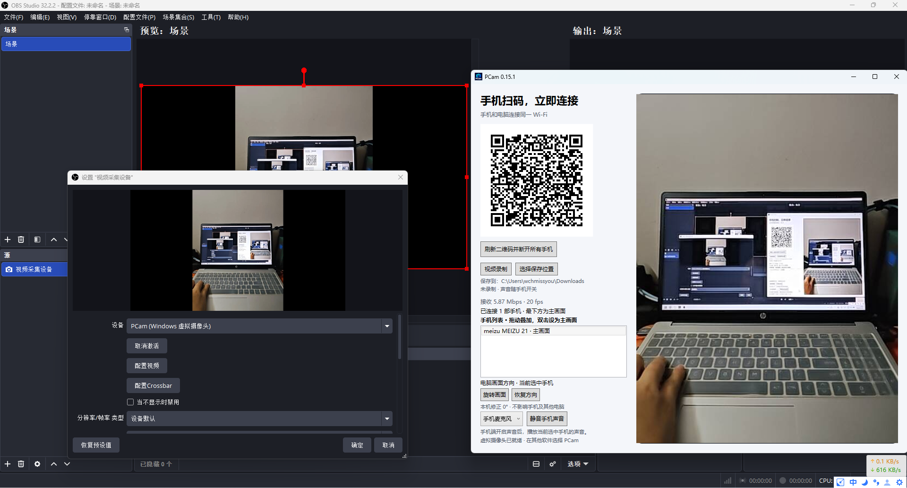
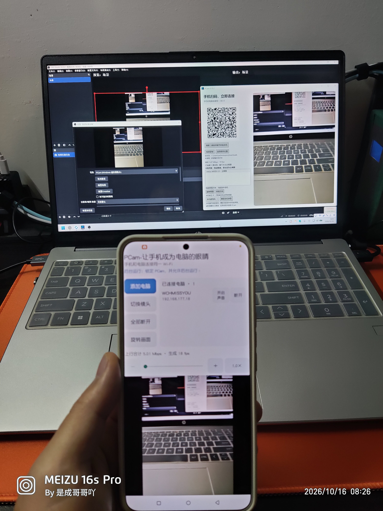
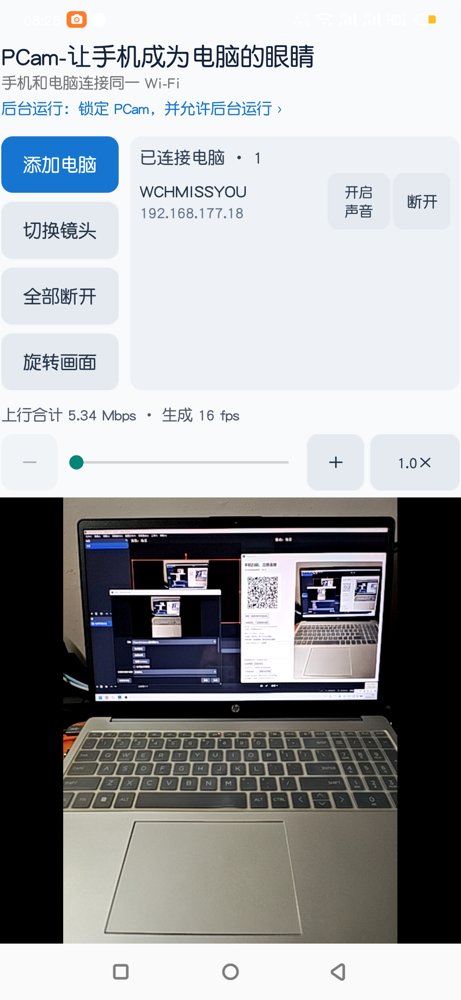
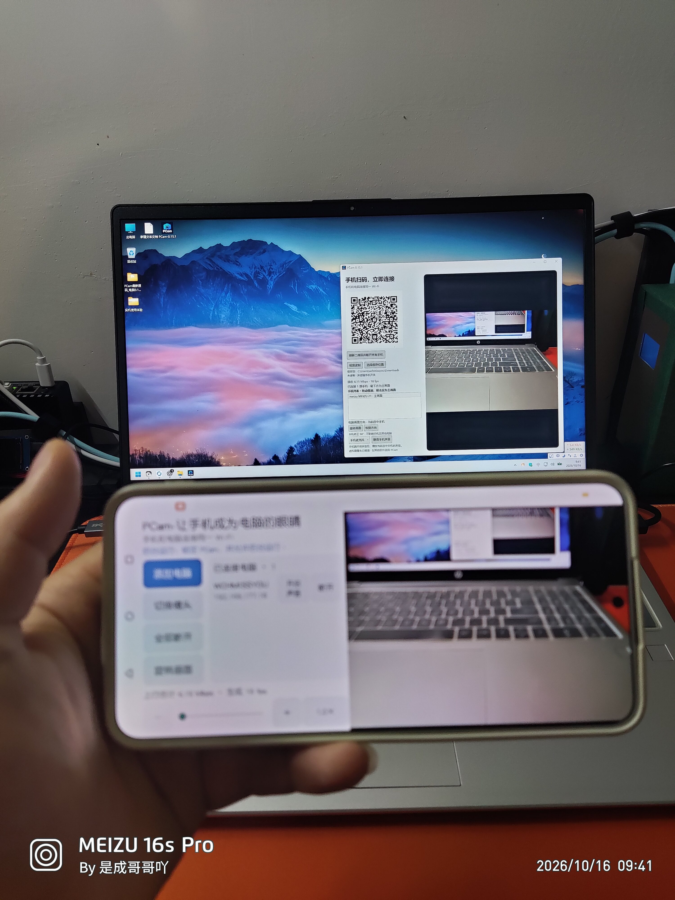

<p align="center"></p>

# PCam — 让手机成为电脑的眼睛

PCam 将 Android 手机的摄像头画面传到 Windows 电脑，支持多机位合成、虚拟摄像头输出和本地录像。适合桌面教学、作品展示、产品演示和会议补充机位。

当前版本：**Windows 0.15.1 / Android 0.12.6**。

## 实机展示

电脑端接收手机画面，并通过PCam虚拟摄像头接入OBS。



<p align="center">
  
  
</p>

<details>
<summary>更多实拍</summary>



</details>

## 功能

- **扫码连接**：手机与电脑连接同一局域网，扫描电脑端二维码即可配对，无需账号。
- **多端连接**：一台电脑最多连接8部手机，一部手机最多添加8台电脑；可分别断开连接和控制声音。
- **画面合成**：最多1个主画面和3个叠加画面。拖动列表调整叠加关系，双击切换主画面，在预览区移动和缩放小画面。
- **虚拟摄像头**：在支持系统虚拟摄像头的软件中选择 `PCam`，使用当前合成画面。按钮、设备名称和编辑边框不会进入输出。
- **手机声音**：授权并开启手机麦克风后传输声音。电脑可以播放、录制当前选中手机的声音；本地播放静音不改变录像音轨。
- **本地录像**：保存合成画面为MP4，默认写入下载目录，也可另选目录。录制时持续暂存，定期整合，异常退出后在下次启动时尝试恢复完整片段。
- **相机控制**：支持前后镜头切换、画面旋转，以及设备允许的变焦和点击对焦。短暂断网后限时重连。

## 使用

1. 运行电脑端，打开手机端，确保两者处于同一局域网。
2. 在手机端点“扫码连接”，扫描电脑二维码；按系统提示授予相机权限。
3. 需要更多机位时，继续连接其他手机并在电脑端调整画面。
4. 需要声音时，在手机端开启对应电脑的声音开关并授权麦克风。
5. 点“视频录制”保存录像；在其他软件中使用画面时，选择摄像头 `PCam`。

首次安装或更新虚拟摄像头组件需要**管理员权限**，请允许 Windows 的权限请求。网络开启客户端隔离时，设备可能无法互相连接。

安装包文件名为 `PCam-0.15.1.exe` 和 `PCam-0.12.6.apk`，发布后可在仓库 Releases 中获取。

Android从0.12.6起使用专用发布签名。已安装旧调试签名版本的用户，需要先卸载旧版再安装，手机端应用设置会被清除。后续发布将沿用这把发布密钥。

## 系统与输出

| 项目 | 要求或规格 |
| --- | --- |
| 电脑 | 完整虚拟摄像头功能需要 Windows 11 x64，Build 22000及以上 |
| 手机 | Android 8.0 / API 26及以上，具备可用摄像头 |
| 手机采集 | 当前优先选择接近640×480的相机预览尺寸，JPEG帧流传输 |
| 虚拟摄像头 | 1280×720，30 fps媒体类型，保持画面比例 |
| 录像 | MP4，H.264视频与AAC音频，编码目标1280×720 / 30 fps |

实际清晰度和帧率受采集尺寸、设备和网络影响。输出为1280×720不代表手机采集达到原生720p。

## 使用限制

- 连接会校验随机配对码，音频令牌绑定视频会话；刷新二维码会撤销旧连接。音画与令牌通过明文 TCP 传输，同网监听者可能截获画面、声音及令牌并冒充设备。二维码不验证电脑身份，请只在可信网络扫描自己的电脑。
- 本机 HTTP 视频输出仅监听 `127.0.0.1`，没有独立认证，本机其他程序可能读取画面；请勿代理或映射到公网。
- 当前提供虚拟摄像头，没有系统虚拟麦克风。会议或直播软件的音频输入需要另行配置。
- 录像约每秒请求刷新临时文件、每分钟整合正式文件。该机制不能保证断电零丢失，也不能替代备份；录制期间磁盘占用可能接近两份。
- 后台与息屏传输受Android和厂商策略限制，摄像头也可能被其他应用抢占。

## 源码

```text
android/          手机端：相机、扫码、音视频传输
windows/          电脑端：接收、预览、合成与录制控制
virtual-camera/   Windows虚拟摄像头；包含改编的微软示例代码
recorder/         Media Foundation录像组件
tests/            单元、协议、跨端及故障测试
assets/           图标资源
licenses/         第三方许可证
```

- [构建说明](BUILD-NOTES.md)
- [代码来源与改动范围](SOURCES.md)
- [第三方依赖](THIRD-PARTY.md)
- [测试方法](TESTING.md)

虚拟摄像头改编自 [Microsoft Windows-Camera](https://github.com/microsoft/Windows-Camera/tree/master/Samples/VirtualCamera) 的VirtualCamera示例，逐文件出处见 `SOURCES.md`，原版权和MIT许可保留。二维码和音频功能使用ZXing、QRCoder和NAudio等依赖，详见 `THIRD-PARTY.md`。

项目自有代码采用 [MIT 许可证](LICENSE)。第三方代码、依赖及相应许可证保持各自许可，见 `SOURCES.md`、`THIRD-PARTY.md` 和 `licenses/`。
